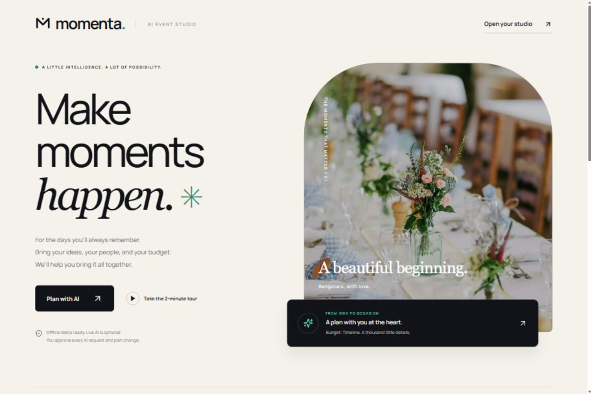
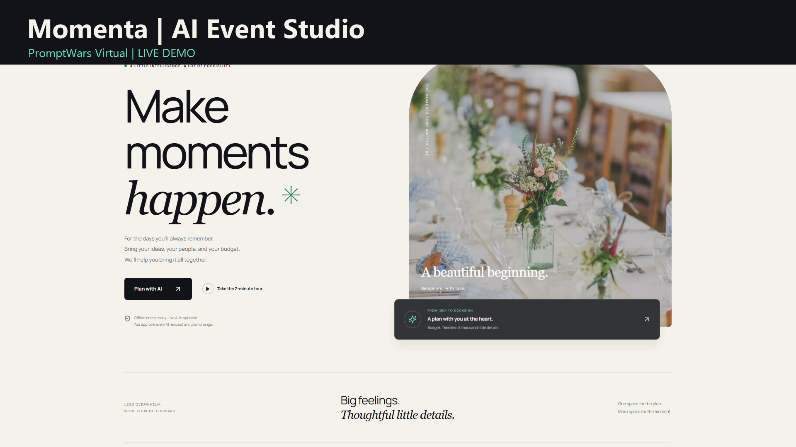
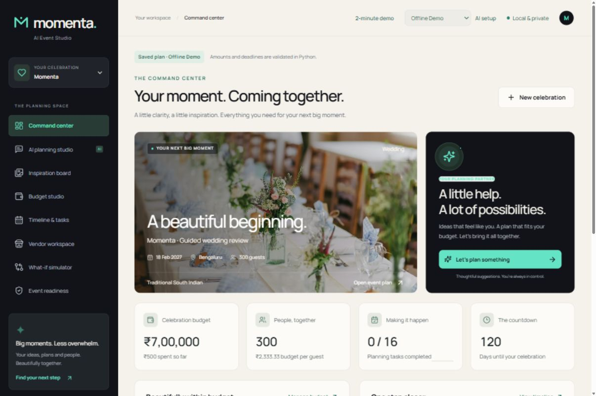
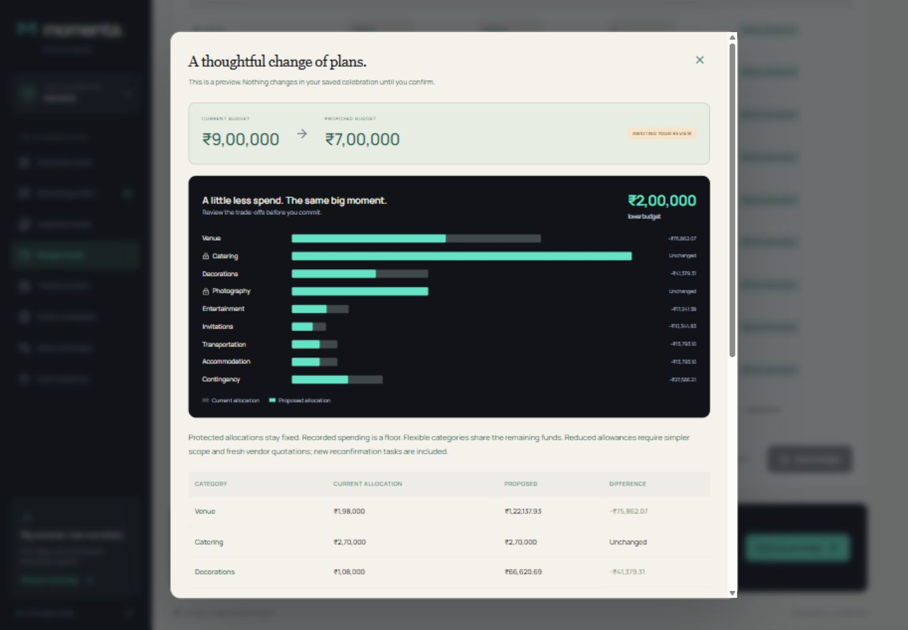
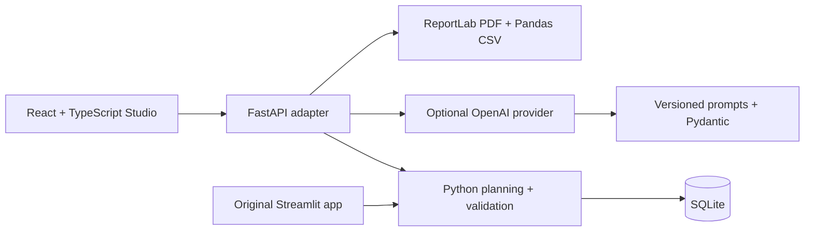

# Momenta — AI Event Studio

**Make moments happen.**

**[Watch the final genuine GenAI demo — 3:36.83](https://drive.google.com/file/d/1XDARxC-xE-c1jaHbw7NWyblc-bSfNNmv/view)** · Drive access is currently restricted; public viewing awaits owner approval.

An AI-assisted celebration planner for weddings, birthdays and community events. Momenta turns a personal brief into budgets, timelines, vendor checklists and creative ideas. Prepared for the **PromptWars Virtual — Celebration & Event Planner** topic supplied by the project owner; no unverified organizer criteria, deadlines or endorsements are claimed.



## Why Momenta

Planning an event means coordinating people, money, dates and hundreds of small decisions. Momenta puts them in one persistent workspace. Its signature **Budget Rescue** protects the expenses that matter when a budget changes, explains trade-offs and lets the host review every change before saving.

## Demo video

[](https://drive.google.com/file/d/1XDARxC-xE-c1jaHbw7NWyblc-bSfNNmv/view)

Verified 1920×1080 / 30 FPS footage shows genuine wedding planning and Budget Rescue responses, live form entry, review and confirmation, timeline, vendors, readiness and PDF export. The impossible-budget validation segment is explicitly labeled deterministic/offline; it makes no model call. The local MP4 is excluded from Git. Drive access is restricted pending approval.

See [secure live setup and approved allowance](submission/LIVE_SETUP.md), [Antigravity workflow](submission/ANTIGRAVITY_WORKFLOW.md), [submission status](submission/STATUS.md), [recording instructions](submission/RECORDING.md) and [hosting plan](submission/HOSTING.md).

## Features

| Experience | Working capabilities |
|---|---|
| Event creation | Three occasion types; date, city, guests, budget, culture, diet and priorities |
| Command Center | Budget health, countdown, progress, milestones and recommendations |
| AI Planning Studio | Context-aware conversation, generation, editable suggestions and save confirmation |
| Budget Studio | Editable allocations/planned/actual spending, currencies and interactive charts |
| Budget Rescue | Protected expenses, exact reallocations, before/after comparisons and updated tasks |
| Timeline & tasks | Relative deadlines, dependencies, calendar, completion and overdue warnings |
| Vendor workspace | Categories, allowances, notes, contacts, priority and booking status |
| Inspiration board | Reference photography, palettes, personalized ideas and saved concepts |
| What-if simulator | Compare budgets, guests, setting and theme without changing a plan |
| Readiness | Transparent rule-based score and separate optional AI critic |
| Exports | Complete PDF plus budget, timeline and vendor CSVs |




## GenAI integration

The server reuses the original Python `LiveProvider`, OpenAI SDK `responses.parse` and Pydantic structured-output validation. Five version-controlled prompt contracts handle **planning, ideas, copilot, rescue and critic**. User descriptions and conversation are treated as untrusted data.

**Offline Demo** uses disclosed templates and deterministic intent handling. **Live AI** makes genuine server-side model requests only when configured and explicitly approved. Selecting a mode never starts a request. Vendor contacts are redacted from context; API keys never enter the browser. Usage limits, timeouts, retry limits and request IDs limit accidental repeat calls. A request limit is not a guaranteed monetary cap.

Models suggest; Python owns money, deadlines and persistence. Proposed changes require separate confirmation. AI criticism is distinguished from the deterministic score. Genuine wedding planning and Budget Rescue were verified with `gpt-6-luna`, structured validation and confirmed persistence. Combined response usage estimated $0.0008649 at the recorded rates. All five endpoints have mocked integration coverage; ideas, copilot and critic have not been separately live-tested. See [AI integration and cost controls](docs/AI_INTEGRATION.md).

## Architecture and stack



Frontend: React, TypeScript, Tailwind, Motion, Radix, Lucide and Recharts. Backend: Python, FastAPI, Pydantic, SQLite, Pandas and ReportLab. Verification: Pytest, Vitest and Playwright. Streamlit/Plotly remains a fallback. Images/fonts are bundled locally; see [asset provenance](docs/ASSETS.md).

## Run locally

Python 3.11+ and Node.js 22+ (verified on Python 3.13/Node 24).

```powershell
python -m venv .venv
.\.venv\Scripts\python -m pip install -r requirements-web.txt
cd frontend
npm ci
npm run build
cd ..
.\.venv\Scripts\python -m uvicorn webapi.app:app --host 127.0.0.1 --port 8000
```

Open **http://127.0.0.1:8000/** and choose **Take the 2-minute tour**. Offline Demo needs no key or external service. Illustrative Bengaluru scenarios include a 300-guest INR 900,000 wedding, 40-guest INR 50,000 birthday and 150-attendee INR 150,000 meetup.

Web data remains at `data/celebrai-web.db`; original Streamlit data remains at `data/celebrai.db`. Legacy module names, environment variables and storage keys preserve compatibility. Do not commit databases.

### Optional Live AI

Configure `OPENAI_API_KEY`, `OPENAI_MODEL` and `CELEBRAI_LIVE_ENABLED=true` in the **server process environment**, then restart Python. `.env.example` documents configuration; `.env` files are not automatically loaded. Never use `VITE_` variables for secrets. Each potentially paid request and persisted proposal still requires explicit approval.

### Original fallback

```powershell
.\.venv\Scripts\python -m streamlit run app.py
```

[Startup details](START_STUDIO.md) · [Frontend guide](frontend/README.md) · [Original application guide](docs/STREAMLIT_GUIDE.md)

## Verification

```powershell
.\.venv\Scripts\python -m pip install -r requirements-test.txt
.\.venv\Scripts\python -m pytest -q
cd frontend
npm test
npm run build
```

Executed: **65 Python tests, 17 frontend tests, production build passed**. Real browser workflows cover creation, generation preview/confirmation, rescue, impossible-budget rejection, readiness and PDF download. See [verification](submission/VERIFICATION.md). Python emits an existing Starlette/httpx TestClient deprecation warning.

## Recording and submission package

Install `requirements-recording.txt`, then follow [RECORDING.md](submission/RECORDING.md). The scripts use actual browser interactions and a fresh private database, add a visible cursor/captions, and verify the MP4. Offline footage is always labeled rehearsal. MP4s, ZIPs, raw footage and private data are excluded from Git.

Target repository name: **`momenta-ai-event-studio`**. The verified video is hosted privately on Drive. No public repository, deployed app or challenge submission receipt exists yet. No paid call, upload, sharing change, push or challenge submission occurs without approval.

## Limitations

Local single-planner MVP; not a hardened multi-user public service. Allowances are illustrative, not actual vendor quotes. Availability and cultural/safety suitability need human review. Readiness is a heuristic, not a guarantee. Two live workflows were verified within the approved allowance; other live workflows retain mocked coverage only. No trademark-clearance claim is made.
